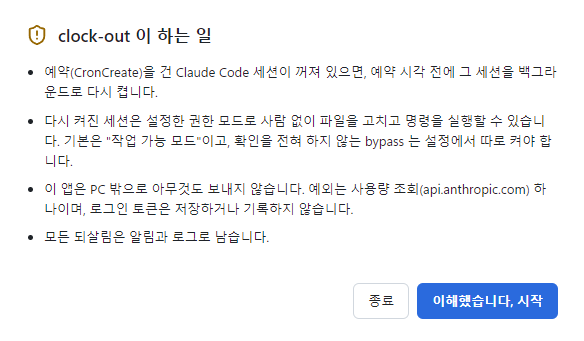
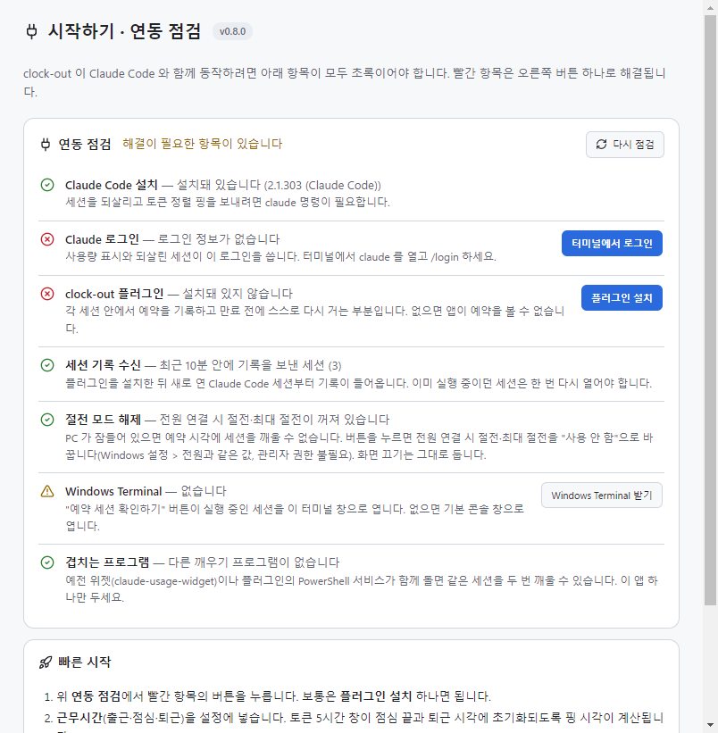
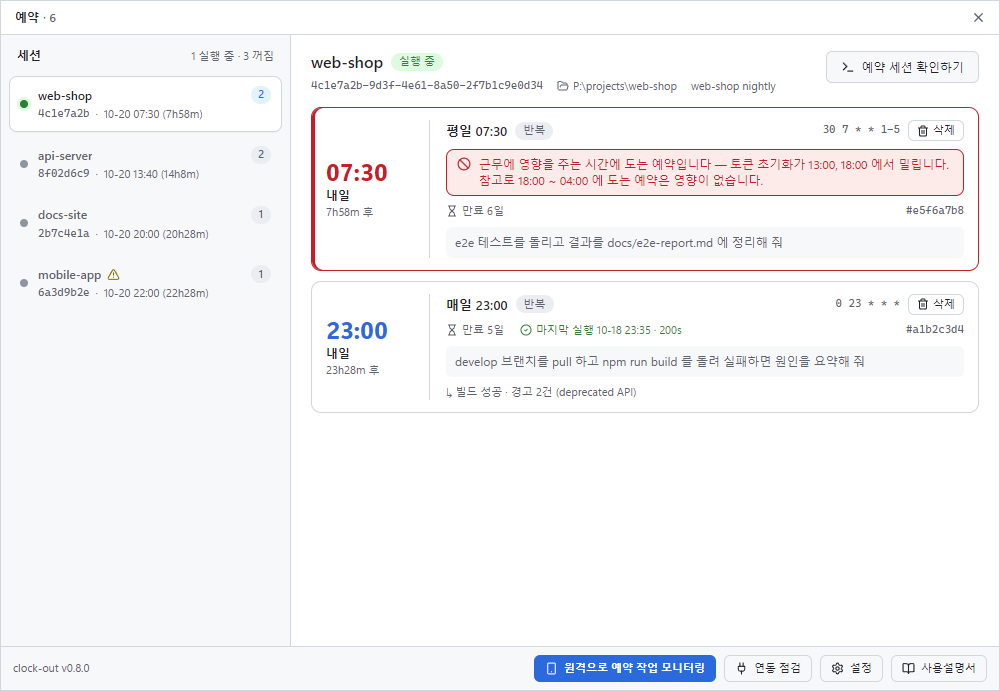
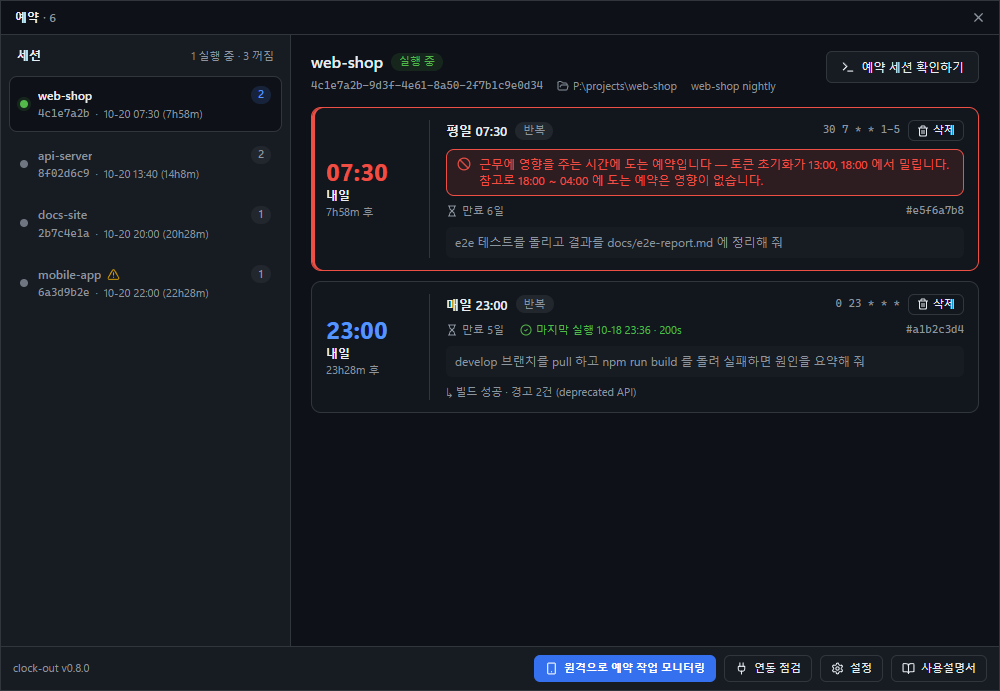
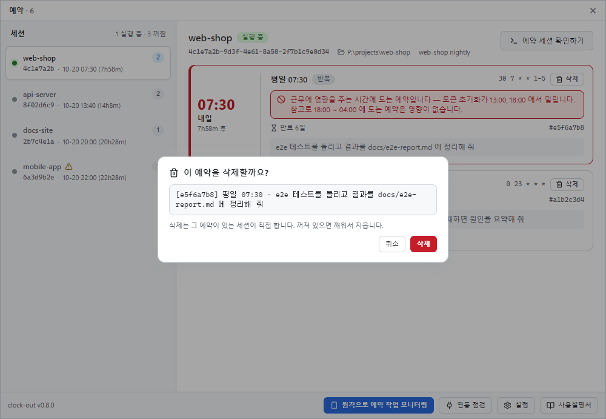
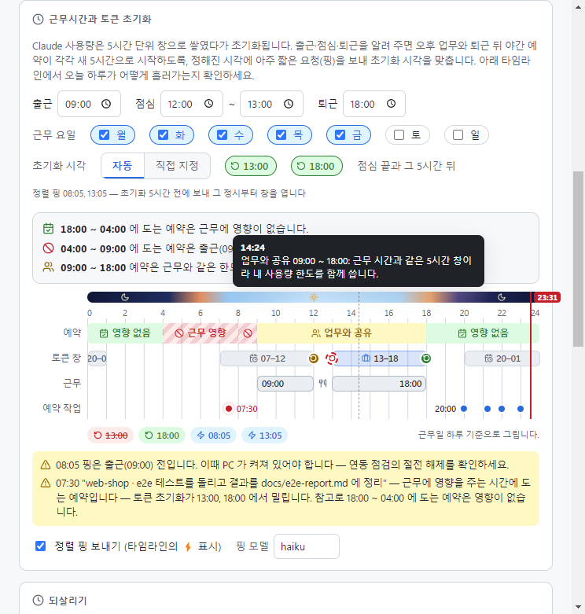
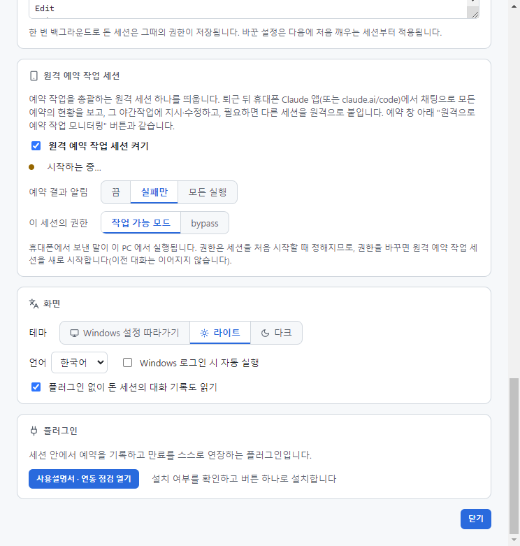
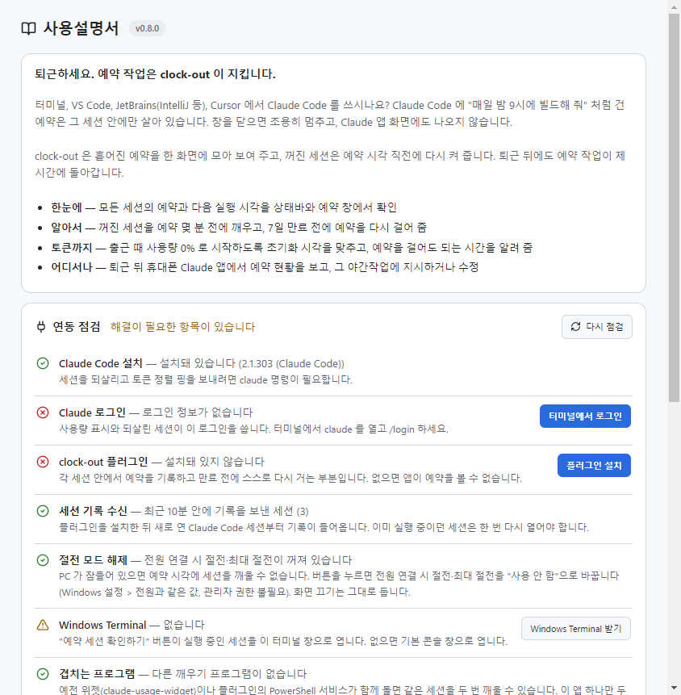

# clock-out

**퇴근하세요. 예약 작업은 clock-out 이 지킵니다.**

터미널, VS Code, JetBrains(IntelliJ 등), Cursor 에서 Claude Code 를 쓰시나요?
Claude Code 에 "매일 밤 9시에 빌드해 줘" 처럼 건 예약은 그 세션 안에만 살아 있습니다.
창을 닫으면 조용히 멈추고, Claude 앱 화면에도 나오지 않습니다.

clock-out 은 흩어진 예약을 한 화면에 모아 보여 주고, 꺼진 세션은 예약 시각 직전에 다시 켜 줍니다.
퇴근 뒤에도 예약 작업이 제시간에 돌아갑니다.

- **한눈에** — 모든 세션의 예약과 다음 실행 시각을 상태바와 예약 창에서 확인
- **알아서** — 꺼진 세션을 예약 몇 분 전에 깨우고, 7일 만료 전에 예약을 다시 걸어 줌
- **토큰까지** — 출근 때 사용량 0% 로 시작하도록 초기화 시각을 맞추고, 예약을 걸어도 되는 시간을 알려 줌
- **어디서나** — 퇴근 뒤 휴대폰 Claude 앱에서 예약 현황을 보고, 그 야간작업에 지시하거나 수정

---

**Clock out. Your Claude Code schedules keep working.**

Using Claude Code in a terminal, VS Code, JetBrains or Cursor? A job you schedule there ("build every night at 9")
lives only inside that session: close the window and it silently stops, and the Claude app never shows it.
clock-out gathers every session's jobs in one place and wakes a stopped session just before its job is due —
so your jobs run on time after you have gone home.


## 왜 clock-out 인가 / Why clock-out

Claude Code 에서 세션이 꺼져도 도는 예약은 이미 있습니다. 그런데 내 PC 의 저장소를 고치고, 어제 하던 작업을 그 세션의 맥락 그대로 이어서 하는 예약은 없습니다.

| 방법 | 내 PC 의 파일·DB | 같은 세션의 맥락 | 세션이 꺼져도 |
| --- | --- | --- | --- |
| Routines (`/schedule`) | 못 씀 — 클라우드에서 실행 | 없음 | 실행됨 |
| Desktop 앱 예약 작업 | 씀 | 없음 — 매번 새 세션 | Desktop 앱이 켜져 있으면 실행됨 |
| `CronCreate` / `/loop` | 씀 | 이어짐 | 멈춤, 반복 예약은 7일 뒤 만료 |
| `CronCreate` + **clock-out** | 씀 | 이어짐 | 꺼진 세션을 깨워 실행, 만료 전에 다시 걸어 줌 |

그래서 "예약 걸어 줘" 라고 하면 Claude 는 `CronCreate` 를 고르고, 그 예약은 세션 창이 닫히는 순간 아무 말 없이 멈춥니다. 퇴근 전에 세션 여러 개를 찾아 켜 두는 일, 다음 날 아침 예약이 왜 안 돌았는지 찾는 일을 clock-out 이 대신합니다.

---

Claude Code already has schedules that run with no session open, but none of them edit a repository on your machine *and* continue yesterday's work with that session's context.

| Option | Your files & DB | Same session's context | Session closed |
| --- | --- | --- | --- |
| Routines (`/schedule`) | no — runs in the cloud | no | runs |
| Desktop app scheduled tasks | yes | no — a new session each run | runs while the Desktop app is open |
| `CronCreate` / `/loop` | yes | yes | stops; recurring jobs expire after 7 days |
| `CronCreate` + **clock-out** | yes | yes | stopped session is woken; jobs renewed before expiry |

So when you say "schedule this", Claude picks `CronCreate`, and the job silently dies with the session window. clock-out takes over the chores of keeping sessions open before you leave and finding out next morning why a job never ran.

**문서 언어 / Language:** [한국어](#한국어) · [English](#english)

## 한국어

### 원격 예약 작업 세션

퇴근 뒤 휴대폰으로 예약을 관리하는 기능입니다. 원격 세션이란 PC 에서 도는 Claude Code 세션을 휴대폰 Claude 앱이나 claude.ai/code 에서 이어서 쓰는 것을 말합니다(Claude Code 의 원격 제어 기능).

예약 창 아래 **원격으로 예약 작업 모니터링** 버튼(또는 상태바 우클릭 메뉴)을 누르면, 예약 작업을 총괄하는 원격 세션 하나가 생깁니다. 이 세션은 휴대폰 Claude 앱이나 claude.ai/code 의 세션 목록에 **"원격 예약 작업"** 으로 나타나고, 거기서 채팅으로 관리합니다.

- **현황 보기** — "예약 현황 보여줘" 라고 하면 모든 세션의 예약, 지금 실행 중인 것, 마지막 결과(✓/✗)를 답합니다.
- **지시·수정** — "tools 세션 예약 22시로 미뤄줘" 처럼 말하면 그 예약이 있는 세션에 지시가 전달되고, 그 세션의 답이 `[clock-out 응답]` 으로 돌아옵니다. 꺼진 세션은 깨워서 전달합니다. 예약은 원래 세션에 그대로 둡니다.
- **다른 세션 원격으로 붙이기** — 그 세션과 직접 대화하고 싶으면 "tools 세션 원격으로 붙여줘" 라고 합니다. 예약이 실행 중이면 "취소되거나 중복 실행될 수 있다" 는 안내가 먼저 나오고, 끝난 뒤 붙일지 지금 붙일지 고릅니다. 다른 세션은 이렇게 요청할 때만 원격이 붙습니다.
- **결과 알림** — 예약이 끝나면 결과를 원격 세션으로 보내고, 원격 세션이 휴대폰 알림으로 넘깁니다. 설정에서 끔 / 실패만(기본) / 모든 실행 중에 고릅니다.

휴대폰에서 보낸 말은 **이 PC 에서 실행**됩니다. 그래서 원격 세션의 권한은 기본이 작업 가능 모드이고, PC 가 켜져 있어야 합니다.

### 무엇을 해 주나요

- **모든 세션의 예약을 한 창에** — 각 세션이 건 예약(`CronCreate`, Claude Code 가 세션 안에서 예약을 거는 도구)을 세션별로 모아, 실제 다음 실행 시각·7일 만료까지 남은 날·마지막 실행 결과와 함께 보여 줍니다.
- **꺼진 세션 깨우기** — 예약 10분 전에 그 세션이 꺼져 있으면 백그라운드로 다시 켭니다(`claude --bg --resume <세션 id>`). 다시 켜진 세션은 대화 기록에서 예약을 되살립니다. 근무 요일에는 퇴근 5분 전에 예약이 남은 꺼진 세션을 한 번에 켭니다.
- **7일 만료 전에 다시 걸기** — Claude Code 의 반복 예약은 건 지 7일이 지나면 사라집니다. 만료 24시간 전에 그 세션이 예약을 스스로 지우고 다시 겁니다. 세션이 꺼져 있으면 만료 하루 전에 깨워서 하게 합니다.
- **5시간 사용량 초기화 맞추기** — Claude 사용량은 5시간 단위 창으로 쌓였다가 초기화됩니다. 근무시간을 알려 주면 정해진 시각에 아주 작은 호출(`claude -p ok --model haiku`, 이하 "핑")을 보내, 오후 업무와 퇴근 뒤 야간 예약이 각각 새 5시간으로 시작하게 합니다. 설정의 타임라인에서 하루가 어떻게 흘러가는지 그림으로 확인합니다.
- **근무에 영향을 주는 시간의 예약 알림** — 어떤 시간에 도는 예약은 출근 때 사용량이 0% 에서 시작하지 못하게 하거나 초기화 시각을 밀어냅니다. 그런 예약은 예약 창과 타임라인에서 빨갛게 표시하고, 플러그인은 그 시간에 새 예약을 걸 때 한 번 거절하며 이유와 영향 없는 시간을 알려 줍니다. 같은 요청을 30분 안에 다시 하면 그대로 걸립니다.
- **원격 예약 작업 세션** — 위 절의 내용입니다.
- **예약 삭제** — 예약 카드의 삭제 버튼으로 지웁니다. 삭제는 그 예약을 가진 세션이 직접 합니다.

### 요구사항

- **Windows 10 · 11**
- **Claude Code CLI 설치와 로그인** — 네이티브 설치(`claude.exe`, 예: `~\.local\bin\claude.exe`) 기준입니다. npm 으로 설치한 claude(`claude.cmd`)는 앱이 찾지 못할 수 있습니다(미검증).
- **원격 기능을 쓰려면** Claude 구독 계정(claude.ai 의 원격 제어를 쓸 수 있는 계정)이 필요합니다.

### 설치

설치 방법은 두 가지입니다. **둘 중 하나만 고르세요.** 섞어 쓰면 아래 "주의" 처럼 설치가 실패합니다.

#### 방법 1 (권장): 데스크톱 앱

1. [Releases](https://github.com/nias2734-wq/clock-out/releases) 에서 `clock-out-setup-x.y.z.exe` 를 받아 실행합니다. 설치 파일에 코드 서명이 없어서 Windows SmartScreen 경고가 한 번 뜹니다 — **추가 정보 → 실행** 을 누릅니다.
2. 첫 실행 때 안내 창(앱이 하는 일과 주의사항)이 뜹니다. 읽고 시작을 누릅니다.

   

3. 이어서 **시작하기 · 연동 점검** 창이 뜹니다. 빨간 항목은 오른쪽 버튼 하나로 해결됩니다. 플러그인이 없으면 **플러그인 설치** 를 누릅니다. 이 버튼은 앱에 들어 있는 플러그인 사본을 다음 명령으로 설치합니다.

   ```
   claude plugin install clock-out --marketplace <앱 설치 폴더>\resources\plugin --scope user -y
   ```

4. 플러그인을 설치한 뒤 **새로 연** Claude Code 세션부터 예약이 기록됩니다. 이미 열려 있던 세션은 한 번 닫았다 다시 여세요.

연동 점검 항목: Claude Code 설치 · Claude 로그인 · clock-out 플러그인 · 세션 기록 수신 · 절전 모드 해제 · Windows Terminal · 겹치는 프로그램.



앱을 쓰면 **`/clock-out:install`(Windows 상주 서비스)은 설치하지 마세요.** 상주 서비스는 앱 없이 꺼진 세션을 깨우는 PowerShell 프로그램인데, 앱이 같은 일을 합니다. 둘 다 돌면 같은 세션을 두 번 깨울 수 있어서, 연동 점검이 그 서비스를 "겹치는 프로그램" 으로 표시합니다.

앱으로 설치한 플러그인은 **앱 설치 폴더에서 바로 불러옵니다.** 그래서 앱을 지우거나 다른 폴더에 다시 설치하면 플러그인도 멈춥니다. 이때는 연동 점검의 플러그인 항목이 빨갛게 바뀌고, 다시 설치하면 됩니다(아래 "주의" 참고).

#### 방법 2: 앱 없이 플러그인만

Claude Code 세션 입력창에서:

```
/plugin marketplace add nias2734-wq/clock-out
/plugin install clock-out@clock-out
```

플러그인만으로도 예약 기록, `/clock-out` 목록, 만료 전 다시 걸기는 됩니다. 꺼진 세션을 깨우려면 Windows 상주 서비스를 추가로 설치합니다.

```
/clock-out:install
```

플러그인 설정은 `/config` → clock-out 에 있습니다(되살리기 몇 분 전 10, 만료 몇 시간 전 24, 매일 되살리기 17:55, 평일만 켜짐, 플러그인 없던 세션의 대화 기록 읽기 꺼짐). 앱을 쓰면 이 값 대신 앱 설정을 씁니다.

#### 주의: 두 방법을 섞지 마세요

두 방법은 같은 이름(`clock-out`)의 marketplace(플러그인 목록 출처)를 서로 다른 곳에서 추가합니다. 하나를 이미 추가한 상태에서 다른 쪽으로 설치하면 `already added from a different source` 로 실패합니다. 바꾸려면 먼저 지우고 다시 설치합니다.

```
claude plugin marketplace remove clock-out
```

이때 플러그인 옵션(`/config` 에서 바꾼 값)도 지워집니다.

### 쓰는 법

#### 상태바

화면 위에 항상 떠 있는 한 줄입니다. 끌어서 원하는 곳에 둡니다. 5시간 · 주간 · 모델별 주간 사용량과 초기화까지 남은 시간(초기화 시각은 마우스를 올리면 보임), 다음 예약, 그리고 버튼(예약 · 종료)이 있습니다. 새로고침 · 원격으로 예약 작업 모니터링 · 설정 · 연동 점검 · 사용설명서는 상태바를 우클릭하면 나오는 메뉴에 있습니다. 되살린 세션이 bypass 모드로 켜지게 설정돼 있으면 빨간 **bypass** 표시가 붙습니다.

#### 예약 창

상태바의 **예약** 을 누르면 바로 아래에 열립니다.



왼쪽은 예약이 있는 세션 목록, 오른쪽은 고른 세션의 예약 카드입니다. 세션 상태는 네 가지입니다.

| 상태 | 뜻 | 끄는 법 |
| --- | --- | --- |
| 백그라운드에서 실행 중 | 창 없이 도는 세션. 창을 닫거나 `/exit` 해도 계속 돌고 예약도 울림 | **세션 끄기** 버튼(`claude stop`) |
| 터미널에서 실행 중 | 터미널 창에서 도는 세션 | 그 창에서 `/exit` |
| 실행 중 | 실행 중이지만 어디서 도는지 알 수 없음 | — |
| 꺼짐 | 꺼진 세션. 예약 전에 clock-out 이 깨움 | — |

백그라운드 세션을 꺼도 예약이 남아 있으면 다음 예약 전에 clock-out 이 다시 켭니다. 아예 안 켜지게 하려면 그 예약을 **숨기기** 합니다.

예약 카드에는 다음 실행 시각(크게), 일정(예: 매일 21:03), 반복/1회, 만료까지 남은 날, 마지막 실행 결과(✓/✗, 걸린 시간, 답 첫 줄)가 나옵니다. **빨간 카드** 는 근무에 영향을 주는 시간에 도는 예약입니다. 카드에 무엇이 밀리는지와 영향 없는 시간이 한 문장으로 적힙니다.

버튼:

- **되살리기** — 꺼진 세션을 지금 백그라운드로 켭니다.
- **예약 세션 확인하기** — 실행 중인 세션을 터미널 창으로 열어 지금 무엇을 하는지 봅니다. 그 창을 닫아도 백그라운드 세션은 계속 돕니다.
- **숨기기** — 꺼진 세션의 그 예약 때문에는 세션을 다시 켜지 않습니다.
- **삭제** — 아래 "예약 삭제" 참고.

⚠ 표시가 붙은 세션은 기록 파일이 이상해서(작업 폴더 없음, 잘못된 id 등) 자동으로 켜지 않습니다.

예약 창 아래의 **원격으로 예약 작업 모니터링** 버튼은 위 [원격 예약 작업 세션](#원격-예약-작업-세션) 을 켭니다.

다크 테마:



#### 예약 삭제

1. 예약 카드의 **삭제** 를 누르면 확인 창이 뜹니다. 어떤 예약인지(id · 시각 · 내용)가 적혀 있습니다.
2. 삭제를 누르면 **그 예약을 가진 세션이 직접** `CronDelete` 로 지웁니다. 세션이 꺼져 있으면 깨워서 지우게 합니다. 처리에는 최대 2분이 걸릴 수 있습니다.
3. 목록에서 사라지면 "예약을 삭제했습니다: [id] …" 가 나옵니다. 백그라운드 세션이면 "세션을 종료하시겠습니까?" 를 묻습니다(그대로 두기 / 세션 종료).

플러그인 없이 터미널에서 도는 세션은 앱이 지시를 보낼 수 없습니다. 이 경우 그 터미널에서 직접 지우라고 안내합니다.



#### 설정

상태바의 톱니바퀴로 엽니다.

- **근무시간과 토큰 초기화** — 출근 · 점심 · 퇴근 · 근무 요일(기본 09:00–18:00, 점심 12:00–13:00, 월–금). 아래 24시간 타임라인에 5시간 창, 초기화 시각, 핑(⚡), 예약이 그려지고, 시간대가 "영향 없음 / 근무에 영향 / 업무와 한도 공유" 로 칠해집니다.
- **초기화 시각** — **자동**(점심 끝과 그 5시간 뒤, 기본값이면 13:00 · 18:00, 핑 08:05 · 13:05) 또는 **직접 지정**(정시를 골라 추가). 앞 초기화 뒤 5시간이 안 되는 시각은 일어날 수 없어서 빨간 취소선으로 표시됩니다.
- **되살리기** — 예약 몇 분 전에 깨울지(10), 반복 예약 만료 몇 시간 전에 깨울지(24), 퇴근 5분 전에 꺼진 세션 모두 깨우기(켜짐), 깨우기 전에 확인, 시험 모드(로그만 남김).
- **되살린 세션의 권한** — 아래 "권한과 보안" 참고.
- **원격 예약 작업 세션** — 켜기, 예약 결과 알림(끔 / 실패만 / 모든 실행), 이 세션의 권한.
- **화면** — 테마(Windows 설정 따라가기 · 라이트 · 다크), 언어(한국어 · English), Windows 로그인 시 자동 실행, 플러그인 없이 돈 세션의 대화 기록도 읽기.





#### 사용설명서

상태바의 **사용설명서** 버튼으로 엽니다. 연동 점검, 빠른 시작, 기능 설명, 문제 해결이 앱 안에 있습니다.



### 권한과 보안

- **되살린 세션의 권한** — 사람이 없는 동안 켜진 세션이므로 권한이 중요합니다. 기본은 **작업 가능 모드** 입니다: 파일 수정(`acceptEdits`)과 허용 도구 목록(기본 `Bash(git *)`, `Bash(npm *)`, `Read`, `Edit`, `Write`, `Glob`, `Grep`)은 묻지 않고 실행합니다. **bypass**(`--dangerously-skip-permissions`, 아무것도 묻지 않음)는 경고 창에서 "위험을 이해하고 켭니다" 를 눌러야 켜지고, 켜지면 상태바에 빨간 표시가 붙습니다.
- **권한은 처음 백그라운드로 켤 때 정해집니다.** 한 번 백그라운드로 돈 세션은 그때의 권한을 기억합니다. 설정을 바꾸면 다음에 처음 깨우는 세션부터 적용됩니다.
- **원격 세션** — 휴대폰에서 보낸 말이 이 PC 에서 실행됩니다. 원격 세션에 bypass 를 주면 휴대폰에서 보낸 말로 이 PC 의 모든 명령이 확인 없이 실행됩니다.
- **설치 파일 서명** — 설치 파일에 코드 서명이 없습니다. 그래서 SmartScreen 경고가 뜹니다(추가 정보 → 실행).
- **로그인 토큰** — 앱은 Claude Code 가 저장한 로그인 토큰(`.credentials.json` 의 OAuth 토큰)을 **사용량 조회에만** 씁니다(`api.anthropic.com/api/oauth/usage`). 토큰을 따로 저장하거나 로그(`app.log`)에 남기지 않습니다. 로그인 여부 점검은 토큰이 있는지만 봅니다.
- **네트워크** — 앱이 직접 보내는 요청은 사용량 조회 하나입니다. 핑·되살리기·원격 세션은 모두 `claude` 명령을 실행하는 것이고, 통신은 Claude Code 가 합니다. 앱은 포트를 열지 않고, 자동 업데이트·원격 전송이 없습니다. 플러그인은 네트워크 API 를 부르지 않습니다.
- **되살릴 때 보내는 첫 메시지** 는 앱 안의 고정 문장입니다("CronList 로 확인하고 빠진 예약만 다시 걸어라"). 기록 파일의 내용을 끼워 넣지 않습니다.

### 데이터 위치

모두 `~/.claude/clock-out/` 아래에 있습니다. 환경 변수 `CLAUDE_CONFIG_DIR`(Claude Code 설정 폴더를 바꾸는 변수)을 쓰면 `<CLAUDE_CONFIG_DIR>/clock-out/` 입니다.

| 경로 | 내용 | 쓰는 쪽 |
| --- | --- | --- |
| `sessions/<세션 id>.json` | 세션별 예약 · 살아 있음 표시 · 실행 결과 | 플러그인(세션마다 자기 파일만) |
| `inbox/<세션 id>/` | 세션 사이 메시지(지시 · 응답 · 알림) | 플러그인, 앱 |
| `requests/` | 플러그인이 앱에 맡기는 요청(깨우기 · 원격으로 다시 열기) | 플러그인 |
| `remote/` | 원격 예약 작업 세션의 작업 폴더(역할을 적은 CLAUDE.md) | 앱 |
| `remote.json` | 원격 예약 작업 세션 상태 | 앱 |
| `overview.json` | 앱이 보여 주는 목록(원격 세션이 읽음) | 앱 |
| `app-settings.json` | 앱 설정 | 앱 |
| `app.log` | 앱 로그(한 줄에 한 사건) | 앱 |
| `config.json` | 상주 서비스 설정(플러그인 옵션을 옮겨 적음) | 플러그인 |

사용량 조회 결과는 임시 폴더의 `claude-usage-cache.json` 에 캐시합니다(사용량 서버가 10분에 5번 넘게 물으면 잠시 막기 때문).

### 알려진 제약

- **PC 가 켜져 있어야 합니다.** 절전·최대 절전 상태면 예약 시각에 세션을 깨울 수 없습니다. 연동 점검의 **절전 끄기** 버튼이 전원 연결 시 절전·최대 절전을 "사용 안 함" 으로 바꿉니다(화면 끄기는 그대로). 출근 전 핑도 그 시각에 PC 가 켜져 있어야 합니다.
- **세션 사이 메시지는 파일로 오갑니다.** 각 세션의 플러그인이 15초마다 자기 inbox 폴더를 읽습니다. 예약이 실행 중이면 끝난 뒤에 처리합니다. 그래서 지시와 응답에 몇 초에서 수십 초가 걸립니다.
- **플러그인 없이 터미널에서 도는 세션에는 지시를 보낼 수 없습니다.** 그 창에서 직접 입력해야 합니다.
- **원격 없이 이미 백그라운드로 돈 세션에는 원격을 붙일 수 없습니다.** 옵션을 다시 주면 다른 id 의 복사본이 생기기 때문입니다. 이런 세션도 지시 전달은 됩니다.
- **사용량 창 규칙** — 5시간 창은 그 창을 여는 첫 호출의 정시부터 5시간입니다. 기본 근무시간(09–18, 점심 12–13)이면 04:00 ~ 09:00 에 도는 예약이 근무에 영향을 줍니다. 예를 들어 04:10 예약은 04:00–09:00 창을 열어 08:05 핑을 무의미하게 만들고, 09시 업무가 09–14 창을 열어 13:00 초기화가 14:00 으로 밀립니다. 08–09시 예약은 출근 때 사용량이 0% 에서 시작하지 못하게 합니다. 정확한 구간은 설정의 타임라인을 보세요.
- **반복 예약은 Claude Code 가 최대 30분 늦게 돌립니다.** 예약 창의 다음 실행 시각은 Claude Code 가 알려 준 실제 시각입니다.
- **같은 세션은 30분 안에 두 번 깨우지 않습니다.**
- **플러그인을 설치하기 전에 열린 세션** 은 기록이 없습니다. 다시 열거나, 설정에서 "플러그인 없이 돈 세션의 대화 기록도 읽기" 를 켜면 대화 기록에서 예약을 찾아 보여 줍니다. 이때 실행 결과·만료 자동 연장·실행 중 판단은 정확도가 떨어집니다.

### 제거

1. **플러그인** — 터미널에서:

   ```
   claude plugin uninstall clock-out@clock-out
   claude plugin marketplace remove clock-out
   ```

2. **상주 서비스** — `/clock-out:install` 로 설치했던 경우에만, 플러그인을 지우기 전에 세션에서 `/clock-out:uninstall` 을 실행합니다.
3. **앱** — Windows 설정 → 앱 → 설치된 앱 → clock-out → 제거.
4. **데이터** — `~/.claude/clock-out/` 폴더를 지웁니다. 앱 제거가 이 폴더를 지우는지는 확인하지 않았습니다(미검증).

### 개발

#### 저장소 구조

```
.claude-plugin/   플러그인 정보(plugin.json)와 marketplace.json
hooks/            플러그인 본체 — 세션 안에서 예약 기록, 만료 전 다시 걸기, inbox, 원격 세션 도구
commands/         /clock-out:install · /clock-out:uninstall
service/          상주 서비스(windows: PowerShell, posix: cron 개요 — 미측정)
tests/            플러그인 테스트(*.test.ts)
app/              데스크톱 앱(Electron + React + TypeScript)
  electron/main/  메인 프로세스 — 되살리기, 연동 점검, 사용량, 원격 세션, 예약 삭제
  src/            화면(상태바, 예약 창, 설정, 사용설명서)
  shared/         메인과 화면이 같이 쓰는 순수 코드, 앱 테스트(*.spec.ts)
scripts/version.js  버전 맞추기
docs/dev-notes/PROGRESS.md  개발 기록
```

**`app/shared/timeline.ts` 와 `hooks/timeline.ts` 는 바이트까지 같은 파일이어야 합니다.** 앱과 플러그인이 같은 계산으로 "근무에 영향을 주는 시간" 을 판단하기 때문입니다. 한쪽을 고치면 다른 쪽에 그대로 복사하세요. 다르면 앱 테스트가 실패합니다.

#### 빌드와 테스트

저장소 루트(플러그인):

```
npm ci                      # 타입 검사용 TypeScript
claude plugin validate .    # 매니페스트, 훅, marketplace 검사
claude plugin test .        # tests/*.test.ts
claude --plugin-dir .       # 작업 중인 폴더의 플러그인으로 세션 실행
```

`app/` 폴더(데스크톱 앱):

```
npm ci
npx tsc --noEmit -p .       # 타입 검사
npx vitest run              # 앱 테스트
npm run dev                 # 개발 실행
npm run dist                # 설치 파일 → app/dist/clock-out-setup-<버전>.exe
```

#### 화면 캡처 모드

`npm run build` 뒤 환경 변수 `CLOCKOUT_SHOT_DIR=<폴더>` 를 주고 `npx electron .` 으로 실행하면, 앱이 창들(상태바, 예약 창, 설정, 사용설명서, 연동 점검 등)을 PNG 로 저장하고 스스로 종료합니다. 이 모드에서는 세션을 깨우지 않습니다. 실제 세션 이름이 찍히지 않게 하려면 `CLAUDE_CONFIG_DIR` 을 가짜 폴더로 지정하고, 그 안에 시연용 세션 파일을 두세요.

#### 버전

플러그인과 앱은 버전 하나를 같이 씁니다(다음 릴리스 0.8.0).

```
node scripts/version.js 0.8.0     # 모든 파일의 버전을 맞춤
node scripts/version.js --check   # 파일끼리 다르거나 CHANGELOG.md 에 그 버전 절이 없으면 실패
```

바뀐 내용은 [CHANGELOG.md](CHANGELOG.md), 개발 중 남긴 기록은 [docs/dev-notes/PROGRESS.md](docs/dev-notes/PROGRESS.md) 에 있습니다.

### 라이선스

MIT — [LICENSE](LICENSE)

## English

### Remote jobs session

Manage your jobs from your phone after work. A remote session is a Claude Code session running on your PC that you continue from the Claude mobile app or claude.ai/code (Claude Code's Remote Control).

Press **Monitor jobs remotely** under the jobs panel (or the status bar's right-click menu): one remote session that oversees every job starts and shows up as **"Remote jobs"** in the Claude mobile app or claude.ai/code. Manage the jobs there by chat.

- **Status** — "show the jobs": every session's jobs, what runs now, the last result (✓/✗).
- **Instructions** — "move the tools job to 22:00": forwarded to the session that owns the job; its answer comes back as `[clock-out 응답]`. A stopped session is woken for it. Jobs stay in their own sessions.
- **Attach another session** — "attach the tools session to remote" to talk to it directly. While a job runs you are told it may be cancelled or run twice, and choose after the job or now. Other sessions get remote only when asked like this.
- **Notices** — finished jobs are reported to the remote session, which pushes them to your phone: off / failures only (default) / every run.

What you type on the phone **runs on this PC**, so the remote session uses work mode by default, and the PC must stay on.

### What it does

- **Every session's jobs in one window** — the jobs each session created with `CronCreate` (Claude Code's in-session scheduling tool), with the real next run, days to the 7-day expiry, and the last result.
- **Wakes stopped sessions** — 10 minutes before a job, a stopped session is started in the background (`claude --bg --resume <session id>`) and restores its jobs from the transcript. On work days, every stopped session that still has jobs is woken 5 minutes before work end.
- **Renews before the 7-day expiry** — recurring jobs expire 7 days after they are created. 24 hours before, the session deletes and re-creates them itself; a stopped session is woken a day before for it.
- **Lines up the 5-hour usage resets** — given your work hours, the app sends a tiny call (`claude -p ok --model haiku`, the "ping") at set times so the afternoon and the nightly jobs each start with a fresh 5-hour window. A timeline in Settings shows the day.
- **Flags jobs in hours that affect work** — such jobs are red in the jobs panel and on the timeline. The plugin refuses a new job in those hours once, with the reason and the hours that have no effect; asking again within 30 minutes goes through.
- **Remote jobs session** — above.
- **Delete a job** — from its card; the session that owns the job deletes it.

### Requirements

- **Windows 10 · 11**
- **Claude Code CLI, installed and signed in** — the native install (`claude.exe`, e.g. `~\.local\bin\claude.exe`). A claude installed with npm (`claude.cmd`) may not be found by the app (unverified).
- **For the remote features**, a Claude subscription that can use Remote Control on claude.ai.

### Install

Pick **one** of the two ways. Mixing them makes the install fail (see "Do not mix" below).

#### Way 1 (recommended): the desktop app

1. Download `clock-out-setup-x.y.z.exe` from [Releases](https://github.com/nias2734-wq/clock-out/releases) and run it. The installer is not code-signed, so Windows SmartScreen warns once — choose **More info → Run anyway**.
2. On the first run a notice explains what the app does. Read it and start.
3. **Get started · setup check** opens next. Each red item is fixed with the button on its right. If the plugin is missing, press **Install plugin**; it installs the copy bundled with the app:

   ```
   claude plugin install clock-out --marketplace <app folder>\resources\plugin --scope user -y
   ```

4. Sessions opened **after** the plugin is installed record their jobs. Reopen sessions that were already running.

With the app, **do not install `/clock-out:install` (the Windows background service).** The app does the same job; with both, a session could be woken twice, and the setup check lists the service under "Overlapping programs".

The plugin installed by the app **loads from the app's install folder**. Uninstalling the app or reinstalling it to another folder stops the plugin; the setup check then shows the plugin in red, and you install it again (see "Do not mix").

#### Way 2: the plugin only, without the app

At the prompt of a Claude Code session:

```
/plugin marketplace add nias2734-wq/clock-out
/plugin install clock-out@clock-out
```

The plugin alone records jobs, lists them with `/clock-out`, and renews them before expiry. To wake stopped sessions, add the Windows background service:

```
/clock-out:install
```

Its options are in `/config` → clock-out (revive lead 10 min, re-register lead 24 h, daily revive 17:55, weekdays only on, legacy transcript scan off). With the app, the app's settings are used instead.

#### Do not mix the two ways

Both add a marketplace (where Claude Code finds the plugin) named `clock-out`, from different sources. Installing the other way afterwards fails with `already added from a different source`. To switch, remove it first and install again:

```
claude plugin marketplace remove clock-out
```

This also clears the plugin's options (values changed in `/config`).

### Using it

**Status bar** — always on top, drag it anywhere: 5-hour, weekly and per-model weekly usage with reset countdowns (the reset time shows on hover), the next job, and buttons (jobs · quit); refresh · monitor jobs remotely · settings · setup check · user guide are on its right-click menu. A red **bypass** pill shows when revived sessions run in bypass mode.

**Jobs panel** — opens under the status bar. Sessions on the left, the chosen session's job cards on the right. A session is *running in the background* (keeps running after its window is closed or `/exit`; stop it with **Stop session**), *running in a terminal* (`/exit` there stops it), *running* (where is unknown), or *stopped* (clock-out wakes it before its job). A stopped background session with jobs left is woken again before the next job; **Hide** the job to keep it off. Cards show the next run, the schedule in words, recurring/one-shot, expiry, and the last result. A **red card** runs in hours that affect work, with one sentence on what it moves. Buttons: **Revive**, **Open session** (opens a running session in a terminal window), **Hide**, **Delete**. ⚠ sessions have a broken record and are never revived automatically.

**Delete a job** — **Delete** on a card opens a confirmation naming the job (id, time, what it does). The session that owns the job deletes it with `CronDelete`; a stopped one is woken for it (up to 2 minutes). When the job has left the list you see "Deleted the job: [id] …", and for a background session "Stop the session too?". A terminal session without the plugin cannot be reached; you are told to delete it there.

**Settings** — *Work hours and token resets* (default 09:00–18:00, lunch 12:00–13:00, Mon–Fri) with a 24-hour timeline; *Reset times*: **Auto** (lunch end and 5 hours later: 13:00 and 18:00, pings 08:05 and 13:05) or **Choose** whole hours (one less than 5 hours after the previous reset cannot happen and is struck through); *Revive* leads and options; permissions; *Remote jobs session*; theme, language, start with Windows, read transcripts of sessions without the plugin.

**User guide** — the **Guide** button on the status bar: setup check, quick start, features and troubleshooting inside the app.

### Permissions and security

- **Revived sessions** run unattended. The default is **work mode**: edits (`acceptEdits`) and an allowed-tools list (default `Bash(git *)`, `Bash(npm *)`, `Read`, `Edit`, `Write`, `Glob`, `Grep`) run without asking. **bypass** (`--dangerously-skip-permissions`) is behind a warning and shows a red pill on the status bar.
- Permissions are set on a session's **first** background start and kept after that; a changed setting applies to sessions woken for the first time afterwards.
- **The remote session** runs what you type on the phone on this PC. With bypass, every command runs without asking.
- **The installer is not code-signed**, hence the SmartScreen warning.
- **Login token** — the app reads Claude Code's OAuth token from `.credentials.json` **only for the usage query** (`api.anthropic.com/api/oauth/usage`). It never stores it elsewhere or writes it to `app.log`.
- **Network** — the usage query is the only request the app makes itself; pings, revivals and the remote session run the `claude` command, and Claude Code does the talking. No port, no auto-update, no telemetry. The plugin calls no network API.
- The first message sent to a revived session is a fixed sentence in the app; nothing from the record files is put into it.

### Where data lives

Under `~/.claude/clock-out/`, or `<CLAUDE_CONFIG_DIR>/clock-out/` when `CLAUDE_CONFIG_DIR` (Claude Code's config folder variable) is set: `sessions/` (one file per session, written only by that session), `inbox/` (messages between sessions), `requests/` (the plugin's wake / reopen requests to the app), `remote/` and `remote.json` (the remote jobs session), `overview.json` (the list the app shows), `app-settings.json`, `app.log`, `config.json` (the background service). The usage answer is cached in the temp folder as `claude-usage-cache.json`.

### Known limits

- **The PC must be awake.** A sleeping PC cannot wake a session. The setup check's **Turn sleep off** sets sleep and hibernate to *never* when plugged in. A ping before work also needs the PC on.
- **Messages between sessions are files**: each session's plugin reads its inbox every 15 seconds (after its running job, if any), so instructions and answers take seconds to tens of seconds.
- **A terminal session without the plugin cannot receive instructions**; type them there.
- **A session that already ran in the background without remote cannot get remote** (a copy would start); instructions still reach it.
- **Usage windows** start on the hour of the first call and last 5 hours. With 09–18 and lunch 12–13, jobs at 04:00–09:00 affect work: a 04:10 job opens 04:00–09:00, so the 08:05 ping does nothing, work opens 09–14, and the 13:00 reset moves to 14:00; a job at 08–09 means work does not start at 0 %. The timeline in Settings shows your exact hours.
- **Claude Code runs recurring jobs up to 30 minutes late**; the panel shows the real next run.
- **A session is never woken twice within 30 minutes.**
- **Sessions opened before the plugin was installed** have no record. Reopen them, or turn on reading transcripts of sessions without the plugin (less accurate: results, renewal and liveness).

### Uninstall

1. Plugin: `claude plugin uninstall clock-out@clock-out`, then `claude plugin marketplace remove clock-out`.
2. Background service: only if you installed it, run `/clock-out:uninstall` in a session before removing the plugin.
3. App: Windows Settings → Apps → Installed apps → clock-out → Uninstall.
4. Data: delete `~/.claude/clock-out/`. Whether the app's uninstaller removes it is unverified.

### Development

- `hooks/` the plugin, `commands/` its install/uninstall commands, `service/` the background service, `tests/` plugin tests, `app/` the desktop app (`electron/main`, `src`, `shared`), `scripts/version.js`.
- **`app/shared/timeline.ts` and `hooks/timeline.ts` must be the same file, byte for byte**; an app test fails when they differ.
- Plugin (repository root): `npm ci`, `claude plugin validate .`, `claude plugin test .`, `claude --plugin-dir .`.
- App (`app/`): `npm ci`, `npx tsc --noEmit -p .`, `npx vitest run`, `npm run dev`, `npm run dist` → `app/dist/clock-out-setup-<version>.exe`.
- Capture mode: after `npm run build`, run `npx electron .` with `CLOCKOUT_SHOT_DIR=<folder>`; the app saves each window as PNG and quits without waking anything. Point `CLAUDE_CONFIG_DIR` at a fake folder with demo session files to keep real session names out.
- Version: `node scripts/version.js 0.8.0` sets it everywhere, `--check` verifies it. See [CHANGELOG.md](CHANGELOG.md) and the development notes in [docs/dev-notes/PROGRESS.md](docs/dev-notes/PROGRESS.md).

### License

MIT — [LICENSE](LICENSE)
